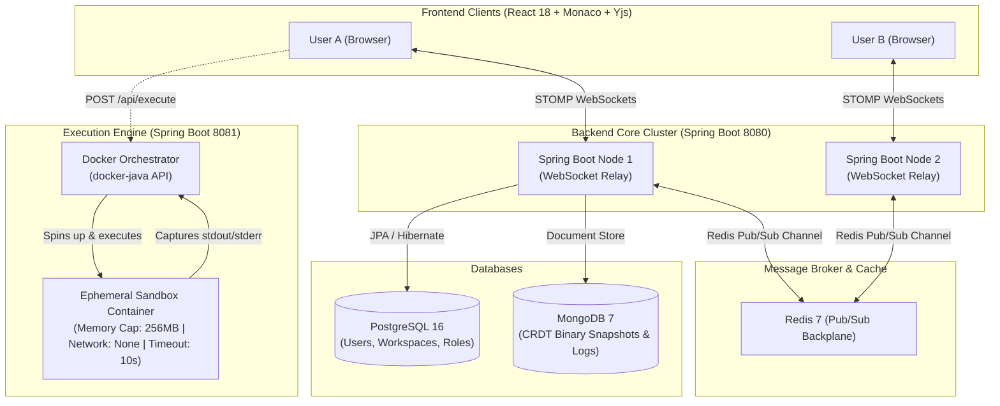

# CodeSync 🚀
### Enterprise-Grade Real-Time Collaborative IDE with Sandboxed Code Execution

[](https://spring.io/projects/spring-boot)
[](https://www.oracle.com/java/)
[](https://react.dev/)
[](https://www.typescriptlang.org/)
[](https://microsoft.github.io/monaco-editor/)
[](https://yjs.dev/)
[](https://www.docker.com/)

**CodeSync** is a cloud-native, real-time collaborative code editor and execution platform. It allows developers across the globe to write, review, and execute code simultaneously in a unified document with zero merge conflicts, sub-millisecond local latency, and sandboxed containerized code execution.

---

## 📑 Table of Contents
- [Key Features](#-key-features)
- [System Architecture](#-system-architecture)
- [Tech Stack](#-tech-stack)
- [Project Directory Structure](#-project-directory-structure)
- [Prerequisites](#-prerequisites)
- [Getting Started](#-getting-started)
- [API & WebSocket Specifications](#-api--websocket-specifications)
- [Sandbox Security Model](#-sandbox-security-model)
- [Troubleshooting & FAQs](#-troubleshooting--faqs)

---

## ⚡ Key Features

* **Conflict-Free Real-Time Editing:** Leverages **Yjs** Conflict-Free Replicated Data Types (CRDTs). Keystrokes merge mathematically on the client without expensive operational transformations (OT) or server-side AST diffing.
* **Live Presence & Remote Cursors:** Broadcasts real-time collaborator avatars, typing carets, and color-coded selection highlights via STOMP WebSockets.
* **Dual Database Architecture:**
  * **PostgreSQL:** Relational metadata (Users, Workspaces, Role-based permissions).
  * **MongoDB:** High-frequency unstructured writes (periodic merged CRDT binary snapshots and incremental delta logs).
* **Multi-Node Cluster Scaling:** Uses a **Redis Pub/Sub backplane** to synchronize WebSocket events seamlessly across multiple backend instances.
* **Sandboxed Code Execution Engine:** Safely runs arbitrary user code (Python, JavaScript/Node.js, etc.) inside ephemeral, resource-constrained Docker containers with complete network isolation (`--network none`).
* **Modern VS Code Experience:** Integrated with **Monaco Editor**, syntax highlighting, smooth scrolling, and dark IDE aesthetics.

---

## 🏛 System Architecture



---

## 🛠 Tech Stack

| Domain | Technology | Description |
| :--- | :--- | :--- |
| **Frontend** | React 18, TypeScript, Vite | Fast, typed, modular user interface |
| **Editor** | Monaco Editor (`@monaco-editor/react`) | VS Code's editor engine in the browser |
| **CRDT Engine** | Yjs, `y-monaco` | Client-side mathematical conflict-free replication |
| **UI Styling** | Tailwind CSS, Lucide Icons | Responsive, sleek dark-mode IDE interface |
| **Backend Core** | Spring Boot 3.4.x, Java 21 LTS | REST endpoints, WebSocket message broker, Security |
| **Real-time Protocol** | Spring WebSocket, STOMP, SockJS | Bi-directional streaming for deltas and presence |
| **Authentication** | Spring Security 6, JJWT (HMAC-SHA256) | Stateless token-based auth |
| **Relational Data** | PostgreSQL 16, Spring Data JPA | Users, workspaces, and role memberships |
| **CRDT Data Store** | MongoDB 7, Spring Data MongoDB | Binary snapshots (`Uint8Array`) and audit logs |
| **Clustering Broker**| Redis 7, Spring Data Redis | Pub/Sub cluster backplane |
| **Execution Engine** | Spring Boot, `docker-java` SDK | Sandboxed Docker runner with process fallback |

---

## 📂 Project Directory Structure

```
CodeSync/
├── infrastructure/               # Local dev setup and database provisioning
│   ├── docker-compose.yml        # PostgreSQL (5432), MongoDB (27017), Redis (6379)
│   └── init-scripts/             
│       ├── postgres-init.sql     # users, workspaces, and workspace_members
│       └── mongo-init.js         # documents & update logs collections
│
├── frontend/                     # React 18 + TypeScript + Tailwind CSS UI
│   ├── public/                   # Favicons and static assets
│   ├── src/
│   │   ├── assets/               # Dark theme styles & Yjs cursor carets
│   │   ├── components/           
│   │   │   ├── editor/           # Monaco Editor & Yjs binding (CodeEditor.tsx)
│   │   │   ├── workspace/        # Sidebar, FileExplorer, ActiveUsersList, ExecutionPanel
│   │   │   └── common/           # Navbar, Button, Modal, Loader
│   │   ├── context/              # AuthContext & WebSocketContext
│   │   ├── hooks/                # useYjsProvider & useWebSockets
│   │   ├── services/             # Axios API services (api.ts, auth.ts, workspace.ts)
│   │   ├── pages/                # Dashboard, EditorRoom, Login, Register
│   │   ├── App.tsx               # Main routing & protected routes
│   │   └── main.tsx              # React DOM entrypoint
│   ├── package.json
│   ├── vite.config.ts            # Proxy to ports 8080 and 8081
│   ├── tailwind.config.js
│   └── tsconfig.json
│
├── backend-core/                 # Main Spring Boot 3.4.3 Application (Port 8080)
│   ├── src/main/java/com/editor/core/
│   │   ├── config/               # WebSocketConfig, SecurityConfig, RedisConfig
│   │   ├── controller/           # AuthController, WorkspaceController
│   │   ├── websocket/            # STOMP message handlers, Session listeners
│   │   ├── service/              # AuthService, WorkspaceService, DocumentSyncService
│   │   ├── repository/           # PostgreSQL JPA & MongoDB Repositories
│   │   ├── model/                # JPA entities (User, Workspace) & Mongo Documents
│   │   ├── dto/                  # Request & response payloads
│   │   └── security/             # JwtTokenProvider, JwtAuthenticationFilter
│   ├── src/main/resources/
│   │   └── application.yml       # PostgreSQL, MongoDB, Redis, JWT config
│   ├── pom.xml
│   └── mvnw.cmd                  # Maven Wrapper
│
└── execution-engine/             # Isolated Code Runner Service (Port 8081)
    ├── src/main/java/com/editor/execution/
    │   ├── config/               # DockerClientConfig (docker-java)
    │   ├── controller/           # /api/execute endpoint
    │   ├── service/              # Sandboxed Docker orchestrator & local fallback
    │   └── dto/                  # ExecutionRequest & ExecutionResult
    ├── src/main/resources/
    │   └── application.yml       # Memory limits, timeout quotas
    ├── pom.xml
    └── mvnw.cmd                  # Maven Wrapper
```

---

## 📋 Prerequisites

Before running the project, verify that your machine has the following tools installed:

* **Java:** `Java 21 LTS` or higher
* **Node.js:** `Node v18+` & `npm 9+`
* **Docker:** Docker Desktop with Docker Compose

---

## 🚀 Getting Started

### Step 1: Start Database & Broker Infrastructure
Start the PostgreSQL, MongoDB, and Redis instances with a single command:
```bash
cd infrastructure
docker compose up -d
```
*Verify containers are running:*
```bash
docker ps
```

### Step 2: Run the Collaboration Backend (`backend-core`)
Open a new terminal tab and start the main Spring Boot server:
```bash
cd backend-core
.\mvnw.cmd spring-boot:run
```
*The backend server will start on `http://localhost:8080`.*

### Step 3: Run the Code Execution Engine (`execution-engine`)
Open another terminal tab and launch the execution service:
```bash
cd execution-engine
.\mvnw.cmd spring-boot:run
```
*The execution engine will start on `http://localhost:8081`.*

### Step 4: Run the Frontend Client (`frontend`)
Open a fourth terminal tab and launch the React development server:
```bash
cd frontend
npm install
npm run dev
```
Open **[http://localhost:3000](http://localhost:3000)** in your browser!

---

## 📡 API & WebSocket Specifications

### REST Endpoints

#### Authentication (`/api/auth`)
| Method | Endpoint | Description | Auth Required |
| :--- | :--- | :--- | :--- |
| `POST` | `/api/auth/register` | Create a new user account | No |
| `POST` | `/api/auth/login` | Authenticate and receive JWT token | No |
| `GET` | `/api/auth/me` | Fetch details of the authenticated user | Yes |

#### Workspaces (`/api/workspaces`)
| Method | Endpoint | Description | Auth Required |
| :--- | :--- | :--- | :--- |
| `GET` | `/api/workspaces` | Get all accessible workspaces | Yes |
| `POST` | `/api/workspaces` | Create a new collaborative room | Yes |
| `GET` | `/api/workspaces/{id}` | Get workspace details (auto-joins as collaborator) | Yes |
| `GET` | `/api/workspaces/{id}/snapshot` | Fetch latest merged CRDT snapshot from MongoDB | Yes |
| `POST` | `/api/workspaces/{id}/snapshot` | Store periodic merged CRDT snapshot | Yes |

#### Remote Code Execution (`/api/execute`)
| Method | Endpoint | Payload | Response |
| :--- | :--- | :--- | :--- |
| `POST` | `/api/execute` | `{ "language": "python", "code": "print('hello')" }` | `{ "stdout": "hello\n", "exitCode": 0, "executionTimeMs": 120 }` |

### STOMP WebSocket Topics

* **Client Send Destinations:**
  * `/app/workspace/{workspaceId}/sync`: Sends binary base64-encoded Yjs updates.
  * `/app/workspace/{workspaceId}/cursor`: Broadcasts live cursor position `(line, column)`.
  * `/app/workspace/{workspaceId}/join`: Announces collaborator presence in the room.
* **Client Subscription Destinations:**
  * `/topic/workspace/{workspaceId}/sync`: Receives peer CRDT deltas.
  * `/topic/workspace/{workspaceId}/presence`: Receives real-time active users list.
  * `/topic/workspace/{workspaceId}/cursor`: Receives peer live cursor highlights.

---

## 🛡 Sandbox Security Model

Executing arbitrary user-submitted code introduces severe Remote Code Execution (RCE) risks. CodeSync enforces multiple layers of sandboxing:

1. **Network Mode:** Explicitly set to `networkMode("none")`. Containers cannot make external HTTP requests, scrape internal networks, or participate in outbound DDoS attacks.
2. **Memory Limits:** Containers are capped at **256MB** memory and 256MB swap to protect the host against memory exhaustion exploits.
3. **Execution Timeouts:** Strict enforcement of a **10-second timeout**. Long-running loops or malicious fork-bombs are killed automatically via `kill` commands.
4. **Lifecycle Cleanup:** Containers are run with `withAutoRemove(true)` and forcefully purged upon process completion.

---

## 👥 Multi-User Collaboration Testing

To test real-time collaboration on your local machine:
1. Open [http://localhost:3000](http://localhost:3000) in **Google Chrome**.
2. Register an account (e.g., `alice`) and create a workspace.
3. Open an **Incognito Window** (or a separate browser like Microsoft Edge / Firefox) and visit [http://localhost:3000](http://localhost:3000).
4. Register a second account (e.g., `bob`).
5. In the second browser, paste the Room ID or room link from `alice`'s session.
6. Watch both users type simultaneously—keystrokes, remote cursors, and active collaborator badges sync instantaneously with zero merge conflicts!

---

## 📄 License
This project is open-source and available under the **MIT License**.
