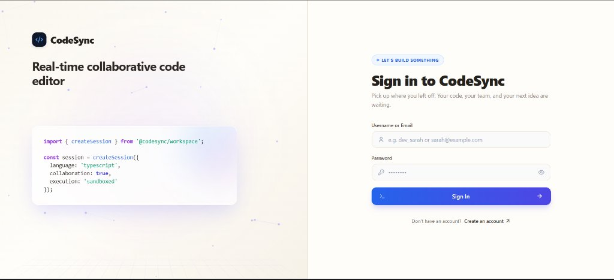
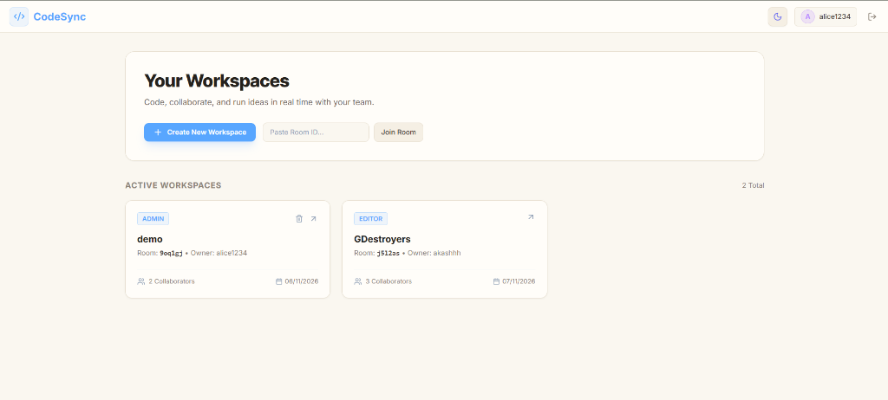
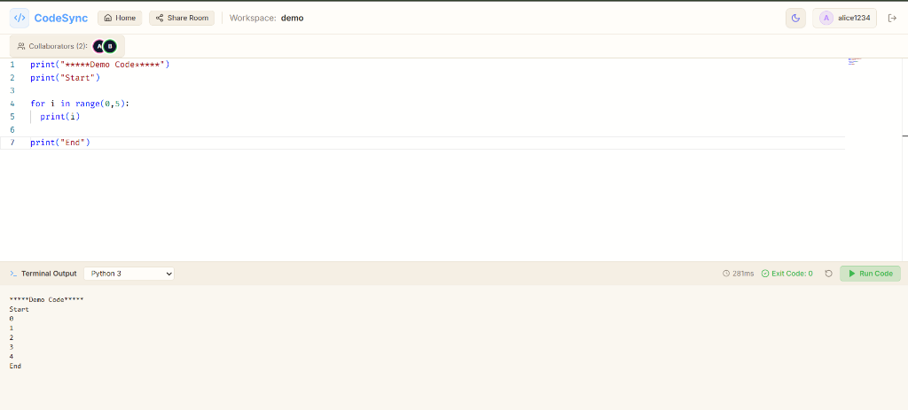

# CodeSync 🚀
### Enterprise-Grade Real-Time Collaborative IDE with Sandboxed Code Execution

[](https://spring.io/projects/spring-boot)
[](https://www.oracle.com/java/)
[](https://react.dev/)
[](https://www.typescriptlang.org/)
[](https://microsoft.github.io/monaco-editor/)
[](https://yjs.dev/)
[](https://www.docker.com/)

**CodeSync** is a cloud-native, real-time collaborative code editor and execution platform. It allows developers across the globe to write, review, and execute code simultaneously in a unified document with zero merge conflicts, sub-millisecond local latency, and sandboxed containerized code execution.

---

## 📑 Table of Contents
- [Application Screenshots](#-application-screenshots)
- [Key Features](#-key-features)
- [System Architecture](#-system-architecture)
- [Tech Stack](#-tech-stack)
- [Project Directory Structure](#-project-directory-structure)
- [Production Deployment (Docker Compose)](#-production-deployment-docker-compose)
- [Local Development Setup](#-local-development-setup)
- [API & WebSocket Specifications](#-api--websocket-specifications)
- [Sandbox Security Model](#-sandbox-security-model)
- [Multi-User Collaboration Testing](#-multi-user-collaboration-testing)
- [License](#-license)

---

## 📸 Application Screenshots

### 1. Authentication & Onboarding
Clean, modern dual-column login and registration interface featuring an animated dynamic network mesh and typing code teaser.



### 2. Workspace Management Dashboard
Quick-start hub to create isolated rooms, join existing sessions via 6-character room codes or share links, and manage active workspaces.



### 3. Collaborative Code Editor & Sandboxed Terminal Execution
Simultaneous multi-client code editing powered by Monaco Editor and Yjs CRDTs, with live collaborator presence indicators and an isolated Docker-backed execution terminal running scripts in real time.



---

## ⚡ Key Features

* **Conflict-Free Real-Time Editing:** Leverages **Yjs** Conflict-Free Replicated Data Types (CRDTs). Keystrokes merge mathematically on the client without expensive operational transformations (OT) or server-side AST diffing.
* **Deterministic Hydration & Zero State Loss:** Database snapshots load first via REST, and WebSocket synchronization handshakes execute sequentially, eliminating race conditions and preventing uninitialized state overwrites.
* **Cross-Platform & Mobile Virtual Keyboard Support:** Strictly enforces uniform `LF` (`\n`) line endings across Windows, Linux, Android, and iOS. Tames mobile IME and Gboard virtual keyboards to prevent phantom line splits or double newlines.
* **Live Presence & Deduplicated Collaborator Avatars:** Real-time collaborator badges with active presence tracking, deduplicating multi-tab sessions cleanly.
* **Dual Database Architecture:**
  * **PostgreSQL 16:** Relational metadata (Users, Workspaces, Role-based permissions).
  * **MongoDB 7:** High-frequency unstructured writes (periodic merged CRDT binary snapshots and incremental delta logs with automatic pruning).
* **Multi-Node Cluster Scaling:** Uses a **Redis Pub/Sub backplane** to synchronize WebSocket events seamlessly across multiple backend instances.
* **High-Throughput WebSocket Transport:** Scaled Spring WebSocket frames up to **1MB** and send buffers to **2MB** to support heavy concurrent typing sessions without dropped frames.
* **Sandboxed Code Execution Engine:** Safely runs arbitrary user code (Python 3, JavaScript/Node.js) inside ephemeral, resource-constrained Docker containers with complete network isolation (`--network none`) and output buffer draining guarantees.
* **Modern VS Code Experience:** Integrated with **Monaco Editor**, syntax highlighting, smooth scrolling, and dynamic **Dark / Light theme** toggling.
* **One-Click Deployment:** Fully containerized multi-tier setup with root `docker-compose.yml`, Nginx reverse proxy, and environment-driven configuration.

---

## 🏛 System Architecture

```mermaid
flowchart TD
    subgraph Clients["Frontend Clients (React 18 + Monaco + Yjs)"]
        UserA["User A (Browser / Mobile)"]
        UserB["User B (Browser / Laptop)"]
    end

    subgraph Proxy["Nginx Reverse Proxy (:80)"]
        Nginx["Nginx Reverse Proxy<br/>(Static SPA, SSL, WS & API Gateway)"]
    end

    subgraph Core["Backend Core (Spring Boot :8082)"]
        Backend["Spring Boot Core Service<br/>(STOMP WebSocket Relay, Auth, CRDT Sync)"]
    end

    subgraph Broker["Clustering & Pub/Sub"]
        Redis[("Redis 7<br/>Active Presence & Pub/Sub Channel")]
    end

    subgraph Storage["Databases"]
        Postgres[("PostgreSQL 16<br/>Users, Workspaces, RBAC")]
        Mongo[("MongoDB 7<br/>CRDT Snapshots & Update Logs")]
    end

    subgraph Sandbox["Execution Engine (:8081)"]
        Worker["Docker Execution Orchestrator<br/>(Spring Boot + docker-java API)"]
        Container["Ephemeral Sandbox Container<br/>(Memory: 256MB | Net: None | Timeout: 10s)"]
    end

    %% Client to Nginx
    UserA -->|HTTP / WebSockets| Nginx
    UserB -->|HTTP / WebSockets| Nginx

    %% Nginx Routing
    Nginx -->|Proxy /ws (STOMP WebSockets)| Backend
    Nginx -->|Proxy /api/auth & /api/workspaces| Backend
    Nginx -->|Proxy /api/execute| Worker

    %% Backend Integrations
    Backend -->|Pub/Sub Events| Redis
    Redis -->|Broadcast Sync| Backend
    Backend -->|Spring Data JPA| Postgres
    Backend -->|Spring Data Mongo| Mongo

    %% Sandbox Execution
    Worker -->|Spins up & injects code| Container
    Container -->|Captures stdout & stderr| Worker
    Worker -->|Returns Execution Result| Nginx
```

---

## 🛠 Tech Stack

| Domain | Technology | Description |
| :--- | :--- | :--- |
| **Frontend** | React 18, TypeScript, Vite | Fast, typed, modular single-page application |
| **Editor** | Monaco Editor (`@monaco-editor/react`) | VS Code's editor engine embedded in the browser |
| **CRDT Engine** | Yjs, `y-monaco`, `y-protocols` | Client-side mathematical conflict-free replication |
| **UI Styling** | Tailwind CSS, Lucide Icons | Responsive, sleek dark/light theme IDE interface |
| **Backend Core** | Spring Boot 3.4.x, Java 21 LTS | REST endpoints, WebSocket STOMP broker, Spring Security |
| **Real-time Protocol** | Spring WebSocket, STOMP, SockJS | Bi-directional streaming for deltas and presence |
| **Authentication** | Spring Security 6, JJWT (HMAC-SHA256) | Stateless token-based auth with auto-join room links |
| **Relational Data** | PostgreSQL 16, Spring Data JPA | Users, workspaces, and role memberships |
| **CRDT Data Store** | MongoDB 7, Spring Data MongoDB | Binary snapshots (`Uint8Array`) and pruned audit logs |
| **Clustering Broker**| Redis 7, Spring Data Redis | In-memory cache and cluster pub/sub backplane |
| **Execution Engine** | Spring Boot, `docker-java` SDK | Sandboxed Docker runner with process fallback |
| **Reverse Proxy** | Nginx (Alpine) | Unified routing for SPA, API, and WebSockets |

---

## 📂 Project Directory Structure

```
CodeSync/
├── docker-compose.yml            # Complete 6-service production orchestration
├── .env.example                  # Environment configuration template
│
├── docs/                         # Project documentation assets
│   └── screenshots/              # UI walkthrough screenshots
│       ├── collaborative-editor.png
│       ├── dashboard-workspaces.png
│       └── login-auth.jpg
│
├── frontend/                     # React 18 + TypeScript + Tailwind CSS UI
│   ├── Dockerfile                # Multi-stage production build (Node 20 -> Nginx Alpine)
│   ├── nginx.conf                # Reverse proxy for static assets, /api, and /ws
│   ├── src/
│   │   ├── assets/               # Light/Dark themes and Monaco styling
│   │   ├── components/           
│   │   │   ├── editor/           # Monaco Editor & Yjs binding (CodeEditor.tsx)
│   │   │   ├── workspace/        # ActiveUsersList, ExecutionPanel
│   │   │   └── common/           # Navbar, Button, Modal, Loader
│   │   ├── context/              # AuthContext & ThemeContext
│   │   ├── hooks/                # useYjsProvider (STOMP + CRDT state sync)
│   │   ├── utils/                # binary.ts (chunked base64 & Uint8Array conversions)
│   │   ├── services/             # Axios API services (auth, workspace)
│   │   ├── pages/                # Dashboard, EditorRoom, Login, Register
│   │   ├── App.tsx               # Main routing & protected routes
│   │   └── main.tsx              # React DOM entrypoint
│   └── package.json
│
├── backend-core/                 # Main Spring Boot 3.4.3 Application (Port 8082)
│   ├── Dockerfile                # Multi-stage container build (Temurin 21)
│   ├── src/main/java/com/editor/core/
│   │   ├── config/               # WebSocketConfig, SecurityConfig, RedisConfig
│   │   ├── controller/           # AuthController, WorkspaceController
│   │   ├── websocket/            # DocumentSyncHandler, WebSocketEventListener
│   │   ├── service/              # AuthService, WorkspaceService, DocumentSyncService
│   │   ├── repository/           # PostgreSQL JPA & MongoDB Repositories
│   │   ├── model/                # JPA entities (User, Workspace) & Mongo Documents
│   │   ├── dto/                  # Request & response payloads
│   │   └── security/             # JwtTokenProvider, JwtAuthenticationFilter
│   └── src/main/resources/
│       └── application.yml       # PostgreSQL, MongoDB, Redis, JWT config
│
├── execution-engine/             # Isolated Code Runner Service (Port 8081)
│   ├── Dockerfile                # Container build with Docker CLI and runtime dependencies
│   ├── src/main/java/com/editor/execution/
│   │   ├── config/               # DockerClientConfig (docker-java SDK)
│   │   ├── controller/           # /api/execute endpoint
│   │   ├── service/              # DockerExecutionService (sandboxed container runner)
│   │   └── dto/                  # ExecutionRequest & ExecutionResult
│   └── src/main/resources/
│       └── application.yml       # Memory limits, timeout quotas
│
└── infrastructure/               # Database initialization scripts
    └── init-scripts/             
        ├── postgres-init.sql     # users, workspaces, and workspace_members
        └── mongo-init.js         # documents & update logs collections
```

---

## 🐳 Production Deployment (Docker Compose)

Deploy the entire CodeSync stack (Frontend, Backend, Execution Engine, PostgreSQL, MongoDB, Redis) in **one command**.

### 1. Configure Environment Variables
```bash
cp .env.example .env
```
Edit `.env` and set your production secrets:
```env
POSTGRES_DB=codesync
POSTGRES_USER=postgres
POSTGRES_PASSWORD=your_secure_postgres_password_here
JWT_SECRET=your_32_byte_random_hex_secret_here
```

### 2. Launch All Services
```bash
docker compose up -d --build
```

### 3. Verify Container Health
```bash
docker compose ps
```
Open **`http://localhost`** (or your server's public IP) in your browser!

---

## 💻 Local Development Setup

If you prefer to run services individually without containerizing the backends:

### Step 1: Start Database Infrastructure
```bash
cd infrastructure
docker compose up -d
```

### Step 2: Run the Collaboration Backend (`backend-core`)
```bash
cd backend-core
.\mvnw.cmd spring-boot:run
```
*Backend runs on `http://localhost:8082`.*

### Step 3: Run the Code Execution Engine (`execution-engine`)
```bash
cd execution-engine
.\mvnw.cmd spring-boot:run
```
*Execution engine runs on `http://localhost:8081`.*

### Step 4: Run the Frontend Client (`frontend`)
```bash
cd frontend
npm install
npm run dev
```
Open **[http://localhost:3000](http://localhost:3000)** in your browser!

---

## 📡 API & WebSocket Specifications

### REST Endpoints

#### Authentication (`/api/auth`)
| Method | Endpoint | Description | Auth Required |
| :--- | :--- | :--- | :--- |
| `POST` | `/api/auth/register` | Create a new user account | No |
| `POST` | `/api/auth/login` | Authenticate and receive JWT token | No |
| `GET` | `/api/auth/me` | Fetch details of the authenticated user | Yes |

#### Workspaces (`/api/workspaces`)
| Method | Endpoint | Description | Auth Required |
| :--- | :--- | :--- | :--- |
| `GET` | `/api/workspaces` | Get all accessible workspaces | Yes |
| `POST` | `/api/workspaces` | Create a new collaborative room | Yes |
| `GET` | `/api/workspaces/{id}` | Get workspace details (auto-joins as collaborator) | Yes |
| `DELETE` | `/api/workspaces/{id}` | Delete workspace and associated documents (Admin only) | Yes |
| `GET` | `/api/workspaces/{id}/snapshot` | Fetch initial state: base snapshot + trailing updates | Yes |
| `POST` | `/api/workspaces/{id}/snapshot` | Store periodic merged CRDT snapshot (rejects empty writes) | Yes |

#### Remote Code Execution (`/api/execute`)
| Method | Endpoint | Payload | Response |
| :--- | :--- | :--- | :--- |
| `POST` | `/api/execute` | `{ "language": "python", "code": "print('hello')" }` | `{ "stdout": "hello\n", "exitCode": 0, "executionTimeMs": 120 }` |

### STOMP WebSocket Topics

* **Client Send Destinations:**
  * `/app/workspace/{workspaceId}/sync`: Sends binary base64-encoded Yjs updates and `sync-step-1` catch-up requests.
  * `/app/workspace/{workspaceId}/awareness`: Broadcasts Yjs awareness states (presence, typing selection ranges).
  * `/app/workspace/{workspaceId}/cursor`: Broadcasts live cursor position `(line, column)`.
  * `/app/workspace/{workspaceId}/join`: Announces collaborator presence in the room.
* **Client Subscription Destinations:**
  * `/topic/workspace/{workspaceId}/sync`: Receives peer CRDT deltas and `sync-step-2` diff responses.
  * `/topic/workspace/{workspaceId}/awareness`: Receives peer Yjs awareness states.
  * `/topic/workspace/{workspaceId}/presence`: Receives deduplicated active users list.
  * `/topic/workspace/{workspaceId}/cursor`: Receives peer live cursor highlights.

---

## 🛡 Sandbox Security Model

Executing arbitrary user-submitted code introduces severe Remote Code Execution (RCE) risks. CodeSync enforces multiple layers of sandboxing:

1. **Network Mode:** Explicitly set to `networkMode("none")`. Containers cannot make external HTTP requests, scrape internal networks, or participate in outbound DDoS attacks.
2. **Memory Limits:** Containers are capped at **256MB** memory and 256MB swap to protect the host against memory exhaustion exploits.
3. **Execution Timeouts:** Strict enforcement of a **10-second timeout**. Long-running loops or fork-bombs are killed automatically.
4. **Lifecycle Cleanup & Stream Draining:** Containers run with `withAutoRemove(true)` and log streams are fully drained before returning execution results.

---

## 👥 Multi-User Collaboration Testing

To test real-time collaboration across multiple devices or browser sessions:
1. Open [http://localhost:3000](http://localhost:3000) (or your deployed URL) in **Google Chrome**.
2. Register an account (e.g., `alice`) and create a workspace.
3. Click the **"Share Room"** button in the navbar to copy the direct room link.
4. Open a second browser (or mobile phone browser connected over network).
5. Register a second account (e.g., `bob`) and join the room link.
6. Watch both users type simultaneously—keystrokes, remote carets, and active collaborator badges sync instantaneously with zero merge conflicts!

---

## 📄 License
This project is open-source and available under the **MIT License**.
